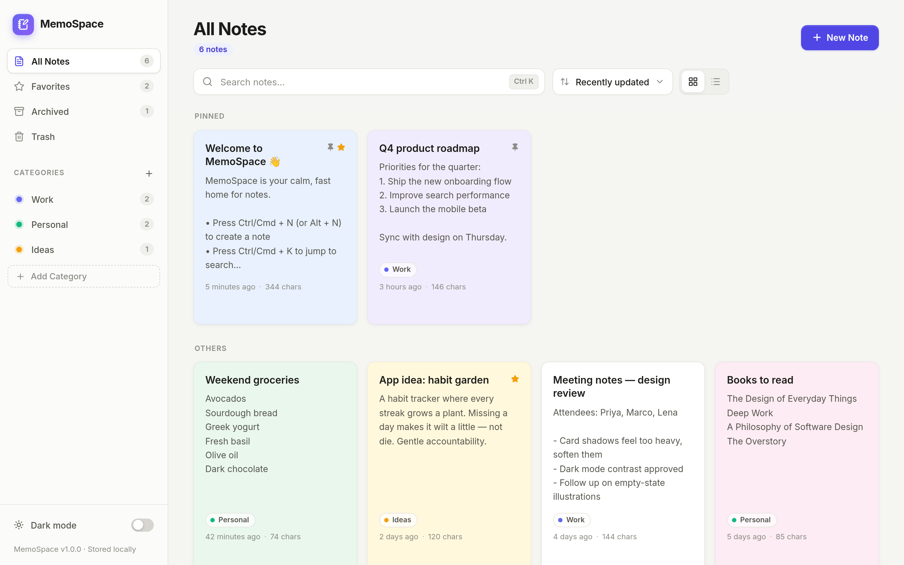
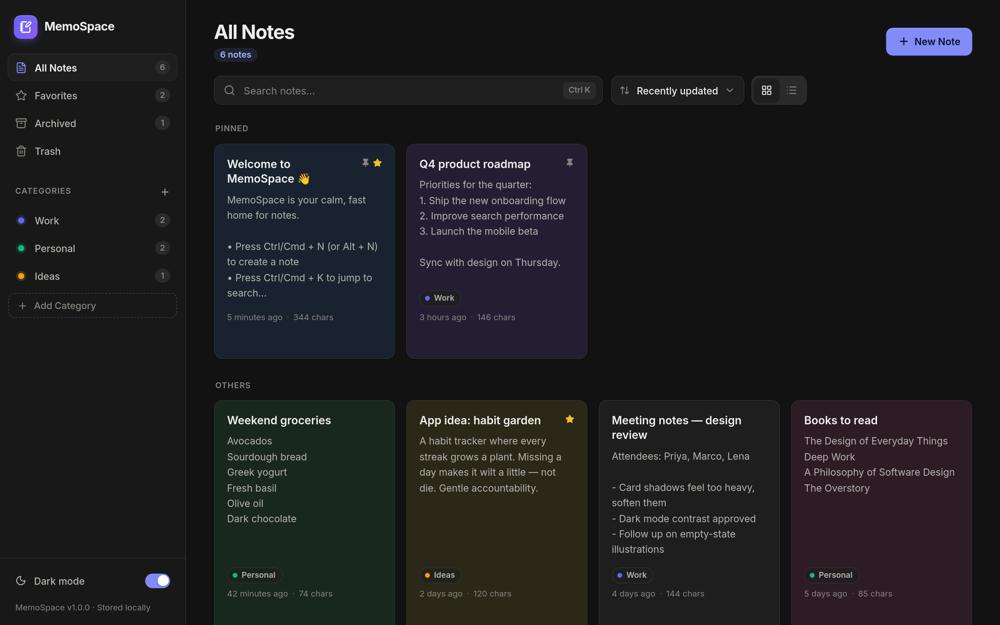
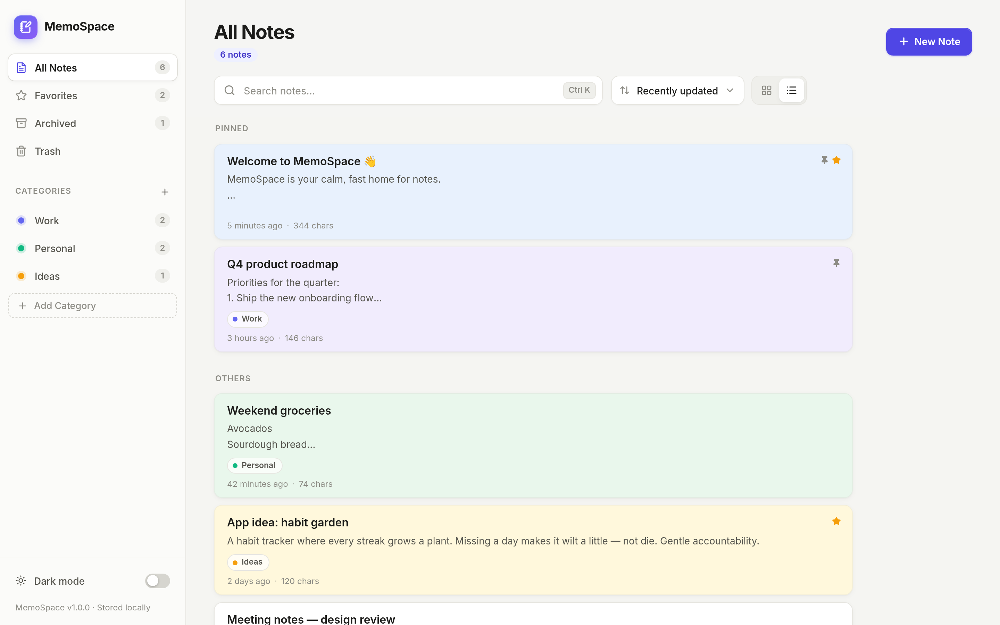
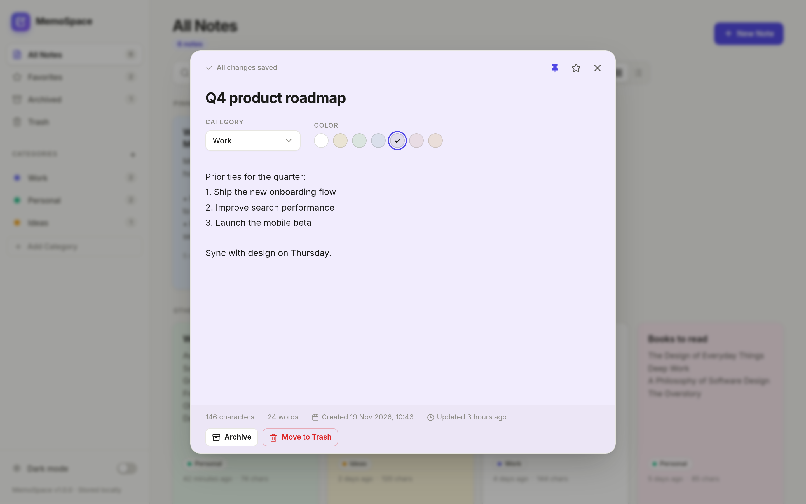
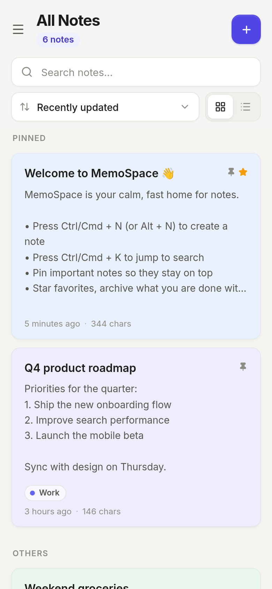
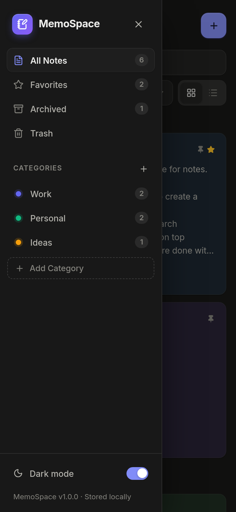

# MemoSpace

A minimal, fast notes app inspired by Notion, Apple Notes and Google Keep. Create, organize and find your notes with a clean, responsive interface in light or dark mode.

MemoSpace runs entirely in your browser. There is no backend and no account: notes are saved to `localStorage` on your device.



## Features

**Notes**
- Create, edit and delete notes with a title and multi-line content
- Changes save automatically as you type; empty new notes are discarded
- Pick a color for each note and assign a category
- See creation and last-updated dates, plus character and word counts

**Organization**
- Pin important notes to the top
- Mark favorites, and archive notes you want to keep out of the way
- Deleted notes go to Trash first. Restore them, delete them forever (with confirmation), or empty the Trash
- Create, rename and delete categories; notes in a deleted category are kept as uncategorized

**Finding notes**
- Instant search across titles and content, with matches highlighted
- Sort by recently updated, recently created or alphabetically
- Switch between grid and list layouts
- Filter by category from the sidebar

**Experience**
- Light and dark themes (follows your system on first visit)
- Responsive layout for desktop, tablet and mobile
- Toast notifications with Undo for trash and archive
- Relative timestamps such as "5 minutes ago"
- Keyboard shortcuts and accessible, labelled controls

## Screenshots

| Dark theme | List view |
| --- | --- |
|  |  |

| Note editor | Mobile | Mobile menu |
| --- | --- | --- |
|  |  |  |

## Tech stack

- [React 19](https://react.dev/) (JavaScript)
- [Vite](https://vite.dev/)
- Plain CSS with custom properties (no CSS framework)
- [Lucide React](https://lucide.dev/) icons
- Browser `localStorage` for persistence
- ESLint

## Getting started

Requirements: [Node.js](https://nodejs.org/) 20.19+ (or 22.12+) and npm.

```bash
git clone https://github.com/<your-username>/<your-repo>.git
cd <your-repo>
npm install
npm run dev
```

Then open the URL Vite prints (usually http://localhost:5173).

### Scripts

| Command | Description |
| --- | --- |
| `npm run dev` | Start the development server |
| `npm run build` | Build for production into `dist/` |
| `npm run preview` | Serve the production build locally |
| `npm run lint` | Run ESLint |

## Keyboard shortcuts

| Shortcut | Action |
| --- | --- |
| `Ctrl/Cmd + N` or `Alt + N` | New note |
| `Ctrl/Cmd + K` | Focus search |
| `Esc` | Close the editor or dialog, or clear the search |

Some browsers (such as Chrome) reserve `Ctrl + N` for opening a new window, so `Alt + N` is provided as a fallback.

## How data is stored

Everything is kept in your browser's `localStorage`:

| Key | Contents |
| --- | --- |
| `memospace:notes` | Array of notes |
| `memospace:categories` | Array of categories |
| `memospace:theme` | `"light"` or `"dark"` |
| `memospace:view-mode` | `"grid"` or `"list"` |
| `memospace:sort` | `"updated"`, `"created"` or `"alpha"` |

- A few demo notes are created on the very first launch only; existing data is never overwritten.
- Stored data is validated on load. If a value can't be read, it is copied to `<key>:corrupt` before the app falls back to a safe default.
- Open tabs stay in sync with each other.
- Data stays on your device. Clearing your browser's site data deletes your notes.

## Project structure

```
src/
  components/   UI components (Sidebar, Header, NoteCard, NoteEditor, ...)
  hooks/        State and behaviour (useNotes, useLocalStorage, useToast, ...)
  utils/        Constants, date formatting, ID generation
  data/         Demo content for the first launch
  App.jsx       App state, filtering and actions
  index.css     Design tokens, themes and all styles
```
